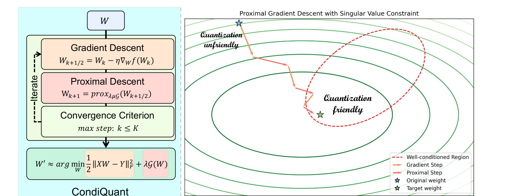
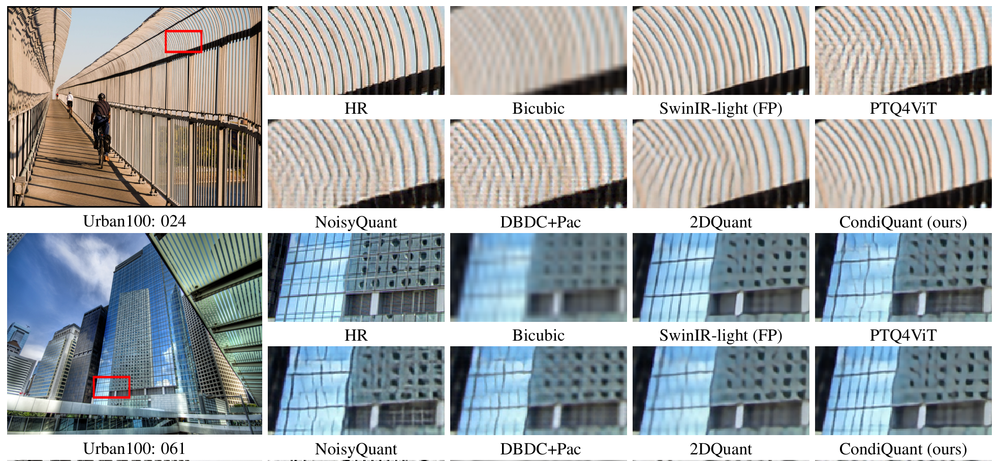

# CondiQuant: Condition Number Based Low-Bit Quantization for Image Super-Resolution

Kai Liu\*, Dehui Wang\*, Zhiteng Li, Zheng Chen, Yong Guo, and Linghe Kong, "Condition Number Based Low-Bit Quantization for Image Super-Resolution", ICML, 2026. \*Equal contribution.

[[Paper](https://proceedings.mlr.press/v306/liu26eh.html)] [[visual results](#results)] [[pretrained models](#models)]

#### News

- **2026:** CondiQuant is accepted at ICML 2026.

---

> **Abstract:** Low-bit model quantization for image super-resolution (SR) is a longstanding task that is renowned for its surprising compression and acceleration ability. However, accuracy degradation is inevitable when compressing the full-precision (FP) model to ultra-low bit widths (2–4 bits). Experimentally, we observe that the degradation of quantization is mainly attributed to the quantization of activation instead of model weights. Considering that the activation quantization error is hard to minimize, minimizing the impact of the error emerges as a good choice, which is described by the condition number. Therefore, we propose CondiQuant, a condition number-based low-bit post-training quantization (PTQ) for image super-resolution. Specifically, we formulate the quantization error of activation as the condition number of weight matrices. By decoupling the representation ability and the quantization sensitivity, we design an efficient proximal gradient descent algorithm to iteratively minimize the condition number and maintain the output. With comprehensive experiments, we demonstrate that CondiQuant outperforms existing PTQ methods in accuracy without computation overhead and gains the theoretically optimal compression ratio in model parameters.

<p align="center"></p>

## Dependencies

- Python 3.9
- PyTorch 2.5.1
- NVIDIA GPU + CUDA

```bash
git clone https://github.com/Kai-Liu001/CondiQuant.git
cd CondiQuant
conda create -n condiquant python=3.9
conda activate condiquant
pip install torch==2.5.1 torchvision==0.20.1 --index-url https://download.pytorch.org/whl/cu124
pip install -r requirements.txt
pip install -e .
```

## Contents

- [Dependencies](#dependencies)
- [Datasets](#datasets)
- [Models](#models)
- [Training](#training)
- [Testing](#testing)
- [Results](#results)
- [Citation](#citation)
- [Acknowledgements](#acknowledgements)

## Datasets

The training and testing datasets can be downloaded as follows:

| Training Set | Testing Set |
|---|---|
| DF2K: [DIV2K](https://data.vision.ee.ethz.ch/cvl/DIV2K/) + [Flickr2K](https://cv.snu.ac.kr/research/EDSR/Flickr2K.tar) ([Google Drive](https://drive.google.com/file/d/1TubDkirxl4qAWelfOnpwaSKoj3KLAIG4/view?usp=share_link) / [Baidu Disk](https://pan.baidu.com/s/1KIcPNz3qDsGSM0uDKl4DRw?pwd=74yc)) | Set5 + Set14 + B100 + Urban100 + Manga109 ([Google Drive](https://drive.google.com/file/d/1yMbItvFKVaCT93yPWmlP3883XtJ-wSee/view?usp=sharing) / [Baidu Disk](https://pan.baidu.com/s/1Tf8WT14vhlA49TO2lz3Y1Q?pwd=8xen)) |

Place the datasets in `datasets/` following the [dataset layout](datasets/README.md).

## Models

Pretrained CondiQuant models cover SwinIR-light at ×2, ×3, and ×4 with 2, 3, and 4-bit weights and activations. Download links will be added soon.

Download the original SwinIR models to `experiments/pretrained_models/SwinIR/`:

```bash
python scripts/download_pretrained.py
```

## Training

Training optimizes the weight condition numbers and quantizer parameters.

- Prepare the [datasets](#datasets) and original [SwinIR models](#models).
- Run `bash scripts/prepare_calibration.sh` to generate calibration data in `keydata/`.
- Run the following command. Training configurations are in `options/train/`.

```bash
# CondiQuant, 4-bit, ×4
bash scripts/train.sh 4 4
```

Use `scripts/train.sh SCALE BITS` for other scales and bit-widths. Checkpoints and logs are saved in `experiments/`.

## Testing

- Place the pretrained CondiQuant models in `experiments/pretrained_models/CondiQuant/` and their calibration files in `keydata/`.
- Prepare the [testing datasets](#datasets) and original [SwinIR models](#models).
- Run the following command. Testing configurations are in `options/test/`.

```bash
# CondiQuant, 4-bit, ×2
bash scripts/test.sh 2 4 experiments/pretrained_models/CondiQuant/CondiQuant_x2_w4a4.pth
```

The output is saved in `results/`.

## Results

Detailed results can be found in the [paper](https://proceedings.mlr.press/v306/liu26eh.html).

<details>
<summary>Click to expand</summary>

Quantitative comparisons in Table 3 (main paper):

| Scale | Bits | Set5 | Set14 | B100 | Urban100 | Manga109 |
|---|---|---|---|---|---|---|
| ×2 | W4A4 | 38.03 / 0.9605 | 33.50 / 0.9180 | 32.16 / 0.8993 | 32.03 / 0.9282 | 38.57 / 0.9769 |
| ×2 | W3A3 | 37.77 / 0.9594 | 33.21 / 0.9151 | 31.94 / 0.8966 | 31.18 / 0.9197 | 38.01 / 0.9755 |
| ×2 | W2A2 | 37.15 / 0.9567 | 32.74 / 0.9103 | 31.55 / 0.8912 | 29.96 / 0.9047 | 36.63 / 0.9713 |
| ×3 | W4A4 | 34.32 / 0.9260 | 30.29 / 0.8417 | 29.05 / 0.8039 | 28.05 / 0.8506 | 33.23 / 0.9431 |
| ×3 | W3A3 | 33.92 / 0.9224 | 30.02 / 0.8367 | 28.84 / 0.7986 | 27.37 / 0.8356 | 32.48 / 0.9367 |
| ×3 | W2A2 | 33.00 / 0.9130 | 29.44 / 0.8253 | 28.45 / 0.7882 | 26.36 / 0.8080 | 30.88 / 0.9203 |
| ×4 | W4A4 | 32.09 / 0.8923 | 28.50 / 0.7792 | 27.52 / 0.7345 | 25.97 / 0.7831 | 30.16 / 0.9054 |
| ×4 | W3A3 | 31.62 / 0.8855 | 28.20 / 0.7715 | 27.31 / 0.7269 | 25.39 / 0.7624 | 29.29 / 0.8915 |
| ×4 | W2A2 | 30.64 / 0.8671 | 27.59 / 0.7567 | 26.93 / 0.7136 | 24.54 / 0.7282 | 27.67 / 0.8613 |

Visual comparisons in Figure 4 (main paper):

<p align="center"></p>

</details>

## Citation

If you find this code helpful in your research, please cite our paper:

```bibtex
@inproceedings{liu2026condiquant,
  title = {Condition Number Based Low-Bit Quantization for Image Super-Resolution},
  author = {Liu, Kai and Wang, Dehui and Li, Zhiteng and Chen, Zheng and Guo, Yong and Kong, Linghe},
  booktitle = {Proceedings of the 43rd International Conference on Machine Learning},
  year = {2026},
}
```

## Acknowledgements

This code is built on [2DQuant](https://github.com/Kai-Liu001/2DQuant), [BasicSR](https://github.com/XPixelGroup/BasicSR), and [SwinIR](https://github.com/JingyunLiang/SwinIR).
